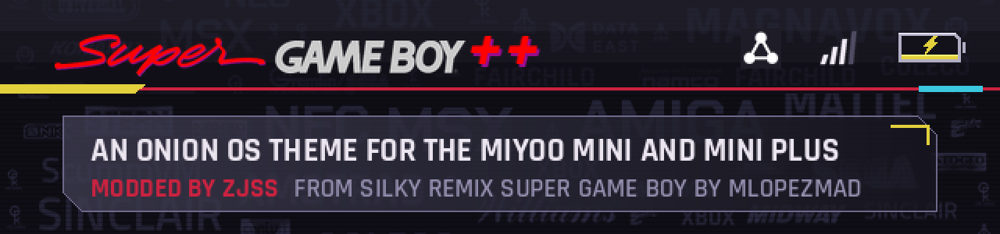
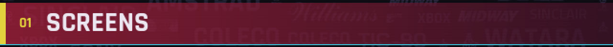
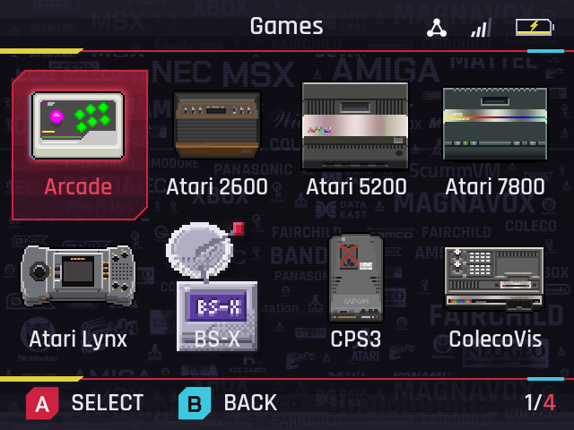
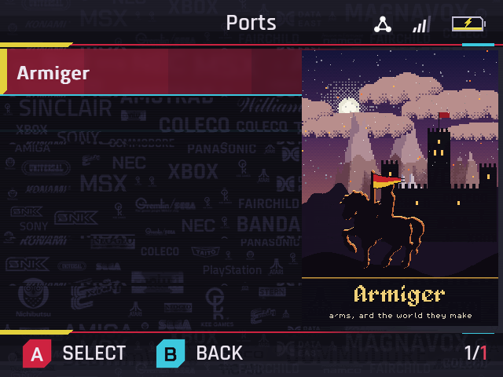
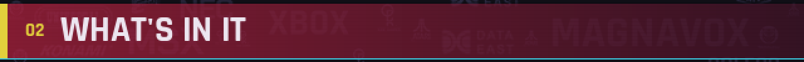
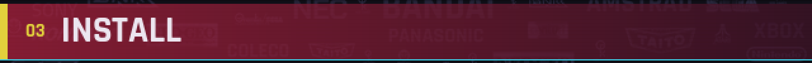
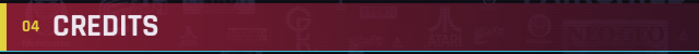
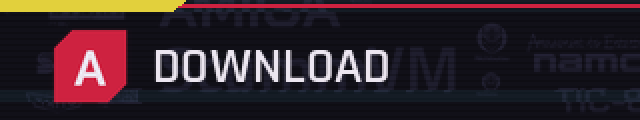
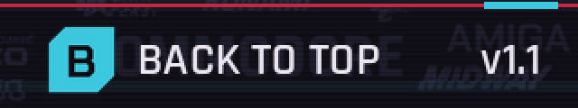

<table>
<tr><td>

An Onion OS theme for the Miyoo Mini and Mini Plus, **modded by ZJSS**. I built it on
[Silky Remix SUPER GAME BOY](https://github.com/OnionUI/Themes/tree/main/themes/Silky%20Remix%20SUPER%20GAME%20BOY%20by%20MLOPEZMAD)
by MLOPEZMAD and added a dash of Cyberpunk 2077 in Super Game Boy red, neon cyan and yellow.

  

 

 

- A wallpaper of console and arcade makers' logos at many sizes. On the main menu the logos light
  up in two waves at once, one travelling down the screen and one up, with a little randomness in
  the timing. Each lit logo has a shining outline running round it.
- Frosted-glass menu cards, title and hint ribbons and list highlights. The glow of a lit logo
  shows through the glass, blurred.
- The Games tile is a handheld whose screen shows a screenshot of the last game you closed. Onion
  saves one each time you leave a game, so it changes as you play.
- The Apps tile's nine squares show the apps you opened most recently, the newest in the middle.
- Pixel-art icons for the main menu, every Onion app, the consoles, the RetroArch cores and the
  settings.
- Battery percentage inside the battery icon, and evenly spaced Wi-Fi and status icons.
- The Super GAME BOY ++ logo in the top bar and in the game switcher.
- A soft chiptune tick when the selection moves and a short rising chime when something opens.
- Rajdhani and Titillium Web fonts.

1. Download the zip from [Releases](https://github.com/zakijss/SuperGameBoy/releases/latest).
2. Copy its two folders, `Themes` and `.tmp_update`, to the root of the SD card, merging them with
   the folders already there. `.tmp_update` is hidden on a Mac: press Cmd+Shift+. in Finder to
   see it.
3. Restart the device and choose the theme in Apps > Themes.

The animated wallpaper and live tiles come from a small program in the theme folder
(`live/sgblive`), started at boot by `.tmp_update/startup/sgblive.sh`. It draws only while this
theme is active and the main menu is on screen, and it stops during games and apps. If you copy
only the theme folder, the theme works as a regular static theme.

To turn the live layer off, delete `/mnt/SDCARD/.tmp_update/startup/sgblive.sh`. What changed in
each version is in the [changelog](CHANGELOG.md).

- Mod: ZJSS (wallpaper, glass, tiles, icons, sounds and the live layer).
- Original theme: Silky Remix SUPER GAME BOY by MLOPEZMAD, from the Onion theme collection.
- Fonts: Rajdhani (Indian Type Foundry) and Titillium Web (Accademia di Belle Arti di Urbino),
  under the SIL Open Font License; the licence texts are in the theme folder. Some text drawn
  into the images uses Chakra Petch (The Chakra Petch Project Authors), also under the SIL Open Font License.
- The company names and logos on the wallpaper are trademarks of their owners and appear for
  decoration only.

</td></tr>
</table>
