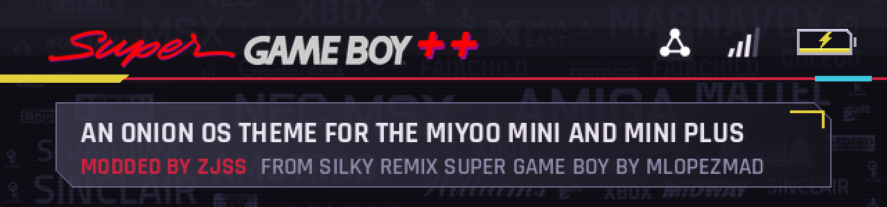
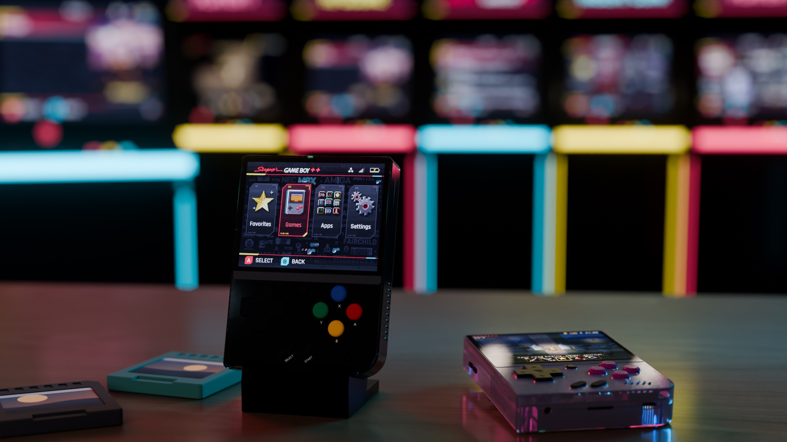
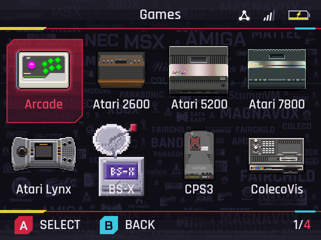
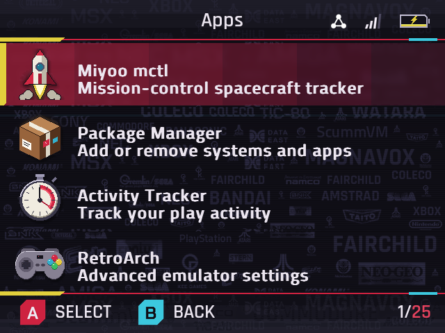
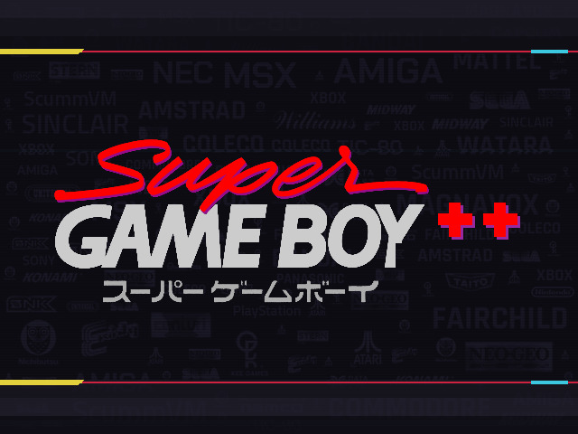
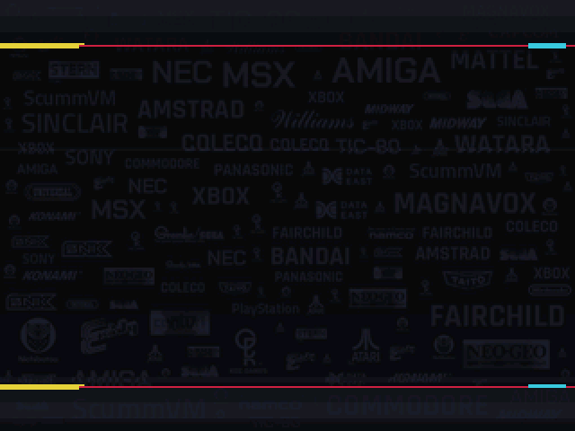
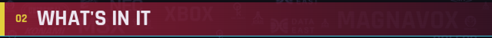
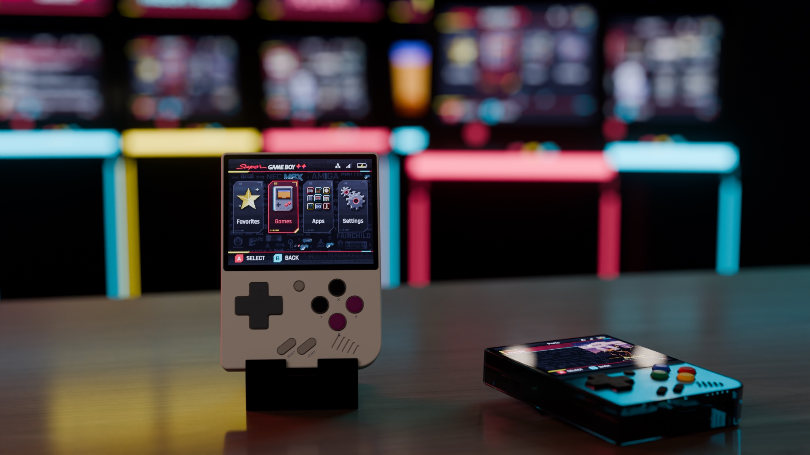
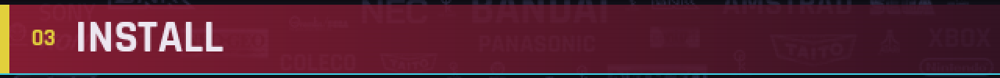
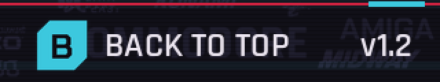

<table>
<tr><td>

An Onion OS theme for the Miyoo Mini and Mini Plus, **modded by ZJSS** from
[Silky Remix SUPER GAME BOY](https://github.com/OnionUI/Themes/tree/main/themes/Silky%20Remix%20SUPER%20GAME%20BOY%20by%20MLOPEZMAD)
by MLOPEZMAD, with a dash of Cyberpunk 2077 in Super Game Boy red, neon cyan and yellow.

**350+ pixel-art icons · 100+ redrawn interface images · 150 logos that light up · new sounds**

  

 

 

 

The boot logo and the RetroArch menu wallpaper, as the image files. Not screenshots.

- A wallpaper of console and arcade makers' logos. On the main menu they light up in two waves,
  one travelling down the screen and one up, each lit logo with a shining outline.
- Frosted-glass menu cards, ribbons and list highlights, with the glow of a lit logo showing
  through.
- Live tiles: the Games tile is a handheld showing the last game you closed, and the Apps tile's
  nine squares show the apps you opened most recently.
- Pixel-art icons for the main menu, every Onion app, the consoles, the RetroArch cores and the
  settings, and pictures for the Ports genre folders.
- Battery percentage inside the battery icon, red below 30 % and outlined in red below 5 %.
- A boot logo for Easy Logotweak, a RetroArch menu theme, a chiptune tick and chime, and the
  Rajdhani and Titillium Web fonts.

Almost every screen is themed: the boot logo, the main menu, the game and app lists, the console
grid, Settings, the game switcher, the switches in Tweaks, the pop-up menus, the RetroArch menu,
and the charging, shutdown, save and low-battery screens.

The icons also come on their own, as an Onion icon pack for any theme: the consoles, every Onion
app and the RetroArch cores, each with a selected version. Download
[SUPER GAME BOY++ by ZJSS.zip](https://github.com/zakijss/SuperGameBoy/releases/latest), unzip it
into `Icons` on the SD card, and pick it in Apps > Tweaks > Appearance > Icon pack. It is in
MiniMart's icon packs too.

Download `Silky.Remix.SUPER.GAME.BOY++.by.ZJSS.zip` from the
[latest release](https://github.com/zakijss/SuperGameBoy/releases/latest) and copy its folders
(`Themes`, `.tmp_update`, `App`, `RetroArch` and `Roms`) to the root of the SD card, merging them
with the folders already there (`.tmp_update` is hidden on a Mac: press Cmd+Shift+. in Finder).
Choose the theme in Apps > Themes, then restart. It is also in **Themes** in
[MiniMart](https://github.com/zakijss/MiniMart), but a theme from a store comes without the boot
hook, so it stays static until you add `.tmp_update` from the full zip.

The animated wallpaper and live tiles come from a small program, `live/sgblive`, started at boot
only when this is the active theme. It takes about 33 MB of memory, so it quits while a game or app
runs and comes back a few seconds after you return to the menu. **SGB Live** in Apps turns it off
and on; below 20 % battery it stops by itself and comes back at 25 %.

<b>Live layer, boot logo and RetroArch menu</b>

**Live layer.** `.tmp_update/startup/sgblive.sh` starts it, and it draws only while the main menu
is on screen. SGB Live keeps its setting as a file, `/mnt/SDCARD/.tmp_update/config/.sgbliveOff`:
off while that file exists. Choosing another theme stops it, and it starts again at the next
restart with this theme or when you open SGB Live. To remove it, delete
`/mnt/SDCARD/.tmp_update/startup/sgblive.sh`. If you copy only the theme folder, the theme works
as a regular static theme.

**Boot logo.** The full zip puts it in `App/EasyLogoTweak/logos/SUPER GAME BOY++ by ZJSS`. Install
[Easy Logotweak](https://github.com/schmurtzm/Miyoo-Mini-easy-logotweak), open it and pick SUPER
GAME BOY++ by ZJSS. It writes the logo to the device's firmware, so read its instructions first.

**RetroArch menu.** The full zip adds `RetroArch/.retroarch/assets/rgui/SUPER GAME BOY++ by
ZJSS.cfg` and its wallpaper. In a game, open the RetroArch menu, go to Settings > User Interface >
Appearance and set Custom Theme Preset to that file (Menu Color Theme stays on Custom, Onion's
default). Save it with Main Menu > Configuration File > Save Current Configuration. To go back,
pick `Onion.cfg` in the same place.

What changed in each version is in the [changelog](CHANGELOG.md).

- Mod: ZJSS (wallpaper, glass, tiles, icons, sounds and the live layer).
- Console icons: Hakchi Pixel Art by faustbear, ported to Onion by Aemiii91, with icons by
  Aemiii91, Smushi and mr_ghetto. ZJSS drew the app and RetroArch core icons and the consoles that
  set lacks.
- Original theme: Silky Remix SUPER GAME BOY by MLOPEZMAD, from the Onion theme collection.
- Fonts: Rajdhani (Indian Type Foundry) and Titillium Web (Accademia di Belle Arti di Urbino),
  under the SIL Open Font License; the licence texts are in the theme folder. Some text drawn
  into the images uses Chakra Petch (The Chakra Petch Project Authors), also under the SIL Open Font License.
- The company names and logos on the wallpaper are trademarks of their owners and appear for
  decoration only.

</td></tr>
</table>
