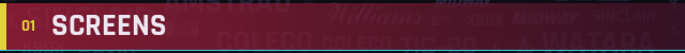
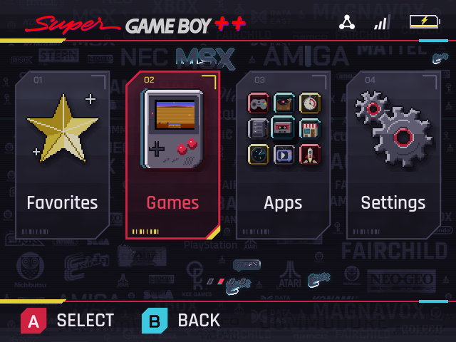
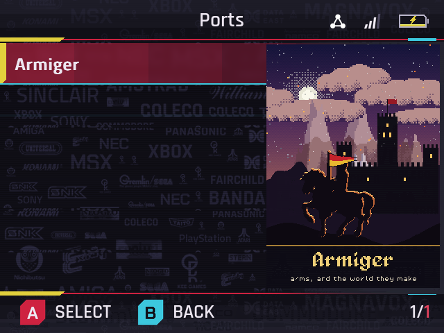
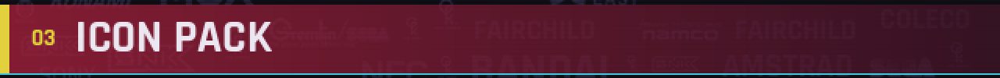
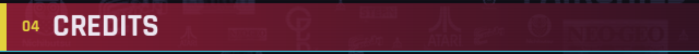
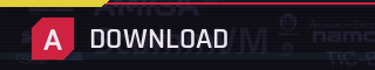

<table>
<tr><td>

An Onion OS theme for the Miyoo Mini and Mini Plus, **modded by ZJSS**. I built it on
[Silky Remix SUPER GAME BOY](https://github.com/OnionUI/Themes/tree/main/themes/Silky%20Remix%20SUPER%20GAME%20BOY%20by%20MLOPEZMAD)
by MLOPEZMAD and added a dash of Cyberpunk 2077 in Super Game Boy red, neon cyan and yellow.

**350+ pixel-art icons · 100+ redrawn interface images · 150 logos that light up · new sounds**

  

 

 

- A wallpaper of console and arcade makers' logos at many sizes. On the main menu the logos light
  up in two waves at once, one travelling down the screen and one up, with a little randomness in
  the timing. Each lit logo has a shining outline running round it.
- Frosted-glass menu cards, title and hint ribbons and list highlights. The glow of a lit logo
  shows through the glass, blurred.
- The Games tile is a handheld whose screen shows a screenshot of the last game you closed. Onion
  saves one each time you leave a game, so it changes as you play.
- The Apps tile's nine squares show the apps you opened most recently, the newest in the middle.
- Pixel-art icons for the main menu, every Onion app, the consoles, the RetroArch cores and the
  settings.
- Battery percentage inside the battery icon, which turns red below 30 % and gets a red outline
  below 5 %, and evenly spaced Wi-Fi and status icons.
- Pictures for the Ports genre folders, Space and RPG among them.
- SGB Live in Apps turns the live wallpaper off and on. Below 20 % battery it stops by itself and
  comes back at 25 %.
- The Super GAME BOY ++ logo in the top bar and in the game switcher.
- A soft chiptune tick when the selection moves and a short rising chime when something opens.
- Rajdhani and Titillium Web fonts.

Almost every screen is themed: the main menu, the game and app lists, the console grid, Settings,
the game switcher, the switches in Tweaks, the pop-up menus, and the charging, shutdown, save and
low-battery screens.

The icons also come on their own, as an Onion icon pack for any theme: the consoles, every Onion
app and the RetroArch cores, each with a selected version. Download
[SUPER GAME BOY++ by ZJSS.zip](https://github.com/zakijss/SuperGameBoy/releases/latest), unzip it
into `Icons` on the SD card, and pick it in Apps > Tweaks > Appearance > Icon pack. It is in
MiniMart's icon packs too.

**Full install, with the animated wallpaper and live tiles:**

1. Download `Silky.Remix.SUPER.GAME.BOY++.by.ZJSS.zip` from
   [Releases](https://github.com/zakijss/SuperGameBoy/releases/latest).
2. Copy its folders, `Themes`, `.tmp_update`, `App` and `Roms`, to the root of the SD card,
   merging them with the folders already there. `.tmp_update` is hidden on a Mac: press
   Cmd+Shift+. in Finder to see it.
3. Choose the theme in Apps > Themes, then restart the device.

**From [MiniMart](https://github.com/zakijss/MiniMart):** open **Themes** and pick Silky Remix SUPER
GAME BOY++. A theme from a store is installed without the boot hook, so it is static until you
add `.tmp_update` from the full zip.

The animated wallpaper and live tiles come from a small program in the theme folder
(`live/sgblive`). `.tmp_update/startup/sgblive.sh` starts it at boot, and only when this is the
active theme. It draws only while the main menu is on screen and stops during games and apps. If
you copy only the theme folder, the theme works as a regular static theme.

To turn the live layer off or on again, open SGB Live in Apps. It keeps the setting as a file,
`/mnt/SDCARD/.tmp_update/config/.sgbliveOff`: off while that file exists. Below 20 % battery the
layer stops on its own and starts again at 25 %. Choosing another theme stops it, and it starts
again at the next restart with this theme or when you open SGB Live. To remove the layer, delete
`/mnt/SDCARD/.tmp_update/startup/sgblive.sh`. What changed in each version is in the
[changelog](CHANGELOG.md).

- Mod: ZJSS (wallpaper, glass, tiles, icons, sounds and the live layer).
- Console icons: Hakchi Pixel Art by faustbear, ported to Onion by Aemiii91, with icons by
  Aemiii91, Smushi and mr_ghetto. ZJSS drew the app and RetroArch core icons and the consoles that
  set lacks.
- Original theme: Silky Remix SUPER GAME BOY by MLOPEZMAD, from the Onion theme collection.
- Fonts: Rajdhani (Indian Type Foundry) and Titillium Web (Accademia di Belle Arti di Urbino),
  under the SIL Open Font License; the licence texts are in the theme folder. Some text drawn
  into the images uses Chakra Petch (The Chakra Petch Project Authors), also under the SIL Open Font License.
- The company names and logos on the wallpaper are trademarks of their owners and appear for
  decoration only.

</td></tr>
</table>
